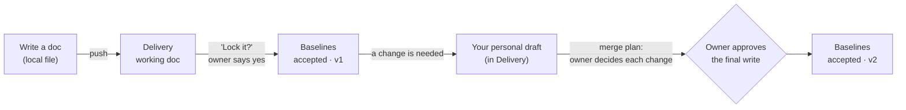

# SDD Tool

**Spec-driven development for teams that build with Claude Code, using Linear as the shared source of truth.**

SDD Tool is a free Claude Code plugin. It gives your team one place for agreed requirements that Claude can trust. Every developer, and their AI agent, can work on their own docs without overwriting anyone else's. Nothing becomes "accepted" until a human says yes.

There's no server and no hosting, and you pay nothing extra. You need Linear's free plan, the Claude Code you already use, and your normal Git workflow, which stays exactly as it is.

---

## Contents

- [Why](#why)
- [How it works](#how-it-works)
- [What you need](#what-you-need)
- [Quick start](#quick-start)
- [Everyday use](#everyday-use)
- [Naming docs](#naming-docs)
- [Security model](#security-model)
- [Files in your repo](#files-in-your-repo)
- [Troubleshooting](#troubleshooting)
- [FAQ](#faq)
- [Manual setup](#manual-setup-without-the-wizard)
- [Contributing](#contributing)

---

## Why

AI coding agents are fast. On a team, though, they cause the same three problems again and again:

1. **Invented requirements.** An agent says "the client wants X" with no source, or works from an old spec.
2. **Drifting context.** Each session, teammate and agent starts from a different idea of what was agreed.
3. **Collisions.** Two people, or two agents, edit the same doc at once and silently overwrite each other.

SDD Tool fixes these with a small set of rules that Claude follows automatically. Where it matters, Linear permissions and approval prompts back the rules up.

---

## How it works

### Two places for docs

The tool uses two teams in a Linear workspace:

| Linear team | What lives there | Who can change it |
|---|---|---|
| **Baselines** | **Accepted** docs: requirements, decisions, anything agreed. | Nobody edits them directly. Changes go through a reviewed merge that the doc's owner approves. |
| **Delivery** | **Working** docs: specs in progress, plans, notes, branch docs, drafts. Any type, any format. | Each doc's owner. |

A doc's location decides whether it's accepted. A doc that just *says* "approved" counts for nothing.

### The lifecycle of a doc



### The rules Claude follows

- **One owner per doc.** You only write to your own docs: your branch doc, your drafts, and docs you created. Changes to shared docs always go through drafts and merges.
- **Personal drafts, reviewed merges.** To change an accepted doc, you fork it into your own draft, and several people can draft the same doc at once. At merge time the owner sees every change, numbered, and picks *keep*, *drop* or *edit* for each one. If someone else changed the same part since you forked, it's flagged as a conflict and the owner picks *draft*, *current*, *both* or *edit*. The version in the title goes up automatically (`… v2` → `… v3`).
- **Local first, then Linear.** Claude edits docs as local files, then pushes them. Push only writes your own docs. If the doc changed in Linear since you pulled it, push refuses and you pull again. Changes that don't overlap with yours merge in automatically. Every write is read back and checked.
- **Honest claims.** Claude keeps accepted requirements (with the doc cited) separate from proposals, observations, assumptions and open questions. It never invents an approval.
- **Branch docs.** Each Git branch gets its own doc (`<Project> / Branch / <branch>`) for notes, decisions, evidence and handoffs. The next session, or the next teammate, picks up where you left off.

### Opt-in and automatic

- **Nobody is forced.** In an SDD repo, at the start of a fresh session, Claude asks once: **"Turn on the SDD Linear tool for this repo?"** The answers are *Yes*, *Not now* (asks again next session) and *No* (stops asking). The choice is per person, and it's never committed. Until you say yes, the tool doesn't contact Linear. Use `/sdd:on` or `/sdd:off` to change it anytime.
- **No waiting.** Once it's on, each session starts with a background check of Linear:
  - an audit of Baselines
  - which accepted docs changed since last time
  - your branch doc
  - its latest handoff
  - any local edits you haven't pushed

  Claude gets a short summary with your first message. You don't run anything.
- **Your context is kept.** The tool never wipes a running session. Docs are only re-read when they've changed or you ask.

---

## What you need

| | |
|---|---|
| **Linear** | A workspace with two free team slots for **Baselines** and **Delivery**. The Free plan works. A dedicated workspace for SDD is simplest. |
| **Claude Code** | CLI, desktop app or IDE extension. |
| **Python 3** | Must run as `python` from the command line. Only the standard library is used (developed on 3.12). On macOS/Linux, if you only have `python3`, add a `python` command (for example `python-is-python3` on Ubuntu, or Homebrew's unversioned link on macOS). |
| **Git** | Your normal workflow. Nothing changes. |

**Cost:** nothing beyond what you already pay for Claude Code. The tool never creates Linear issues, so the Free plan's 250-issue limit doesn't matter.

---

## Quick start

### 1. Prepare Linear (once per workspace)

In Linear, open **Settings → Teams** and make two teams named exactly **Delivery** and **Baselines**. On the Free plan, rename the default team to *Delivery* and add *Baselines*. The setup wizard checks for these teams and prints these steps if they're missing.

### 2. Set up your computer (once per person)

```bash
git clone https://github.com/Razrocks/SDD-TOOL
python SDD-TOOL/plugins/sdd/scripts/sdd_setup.py dev
```

The wizard walks you through creating your personal Linear API keys and shows the exact clicks for each one. For each key, it:

- takes your paste with the input hidden
- checks live that the key has exactly the access it should, no more and no less
- saves it as a user environment variable (Windows) or in your shell profile (macOS/Linux)

At the end it adds the SDD plugin marketplace to Claude Code. Then **fully quit Claude and reopen it** so it sees the keys.

### 3. Add SDD to a repo (once per repo, by one person)

```bash
cd your-repo
python ../SDD-TOOL/plugins/sdd/scripts/sdd_setup.py project
```

The wizard asks for a **doc prefix**, the project name that starts every doc title, such as `Dice Roller`. It then writes three files. **Commit all three:**

- `.sdd/project-map.json`
- `.claude/settings.json`
- `.gitignore` updates

When teammates clone the repo, Claude prompts them to install the plugin. They only need step 2.

### 4. Open the repo in Claude

Accept the plugin when Claude asks, answer **Yes** to the SDD question, and work as usual.

If anything seems wrong, run the check. It looks at your keys, access, certificates, the plugin and the project map, and gives a fix for each problem:

```bash
python SDD-TOOL/plugins/sdd/scripts/sdd_setup.py check
```

Inside Claude you can also run `/sdd:setup`.

---

## Everyday use

Mostly you just talk to Claude. It follows the rules on its own. These shortcuts are there when you want them:

| Command | What it does |
|---|---|
| `/sdd:on` · `/sdd:off` | Turn the tool on or off in this repo, for you only. |
| `/sdd:resume` | Full re-check: audit, accepted docs, branch doc, latest handoff, code state. You rarely need it, because sessions start with this automatically. |
| `/sdd:branch` | Open (or create) the doc for your current Git branch. |
| `/sdd:checkpoint` | Save a handoff to your branch doc: what changed, evidence, open questions, next step. |
| `/sdd:draft` | Fork an accepted doc into your own draft. |
| `/sdd:merge` | Merge a draft back. The owner reviews every change, then approves the write. |
| `/sdd:lock` | Make a working doc accepted (moves it to Baselines after you say yes). |
| `/sdd:merged` | After a PR merges: close the branch doc and regenerate the "as-built" docs from `main`. |
| `/sdd:setup` | Run or explain the setup wizard. |

### Example: changing an accepted requirement

1. You: *"Requirement 2 should allow up to 10 dice."* Claude creates your draft, `Dice Roller / Requirements v3 / draft (Alex, feature-x)`, edits it locally and pushes it.
2. You: `/sdd:merge`. Claude shows the doc title and each change, for example *"1. CHANGED: max 6 dice → max 10 dice: keep / drop / edit?"*, and you pick.
3. Claude Code shows a permission prompt naming the doc. You approve, and the accepted doc becomes `Dice Roller / Requirements v4`, read back and verified.

### Example: making a new doc accepted

Claude writes `Dice Roller / API contract` in Delivery. When the team agrees on it, Claude asks *"Lock "Dice Roller / API contract"?"* You say yes, approve the permission prompt, and the doc moves to Baselines.

### Under the hood: editing a doc

Claude does this for you, and the scripts can also be run by hand:

```bash
python <plugin>/scripts/sdd_docs.py pull <doc id>    # copy to .sdd/work/<name>.md
# ...edit the file...
python <plugin>/scripts/sdd_docs.py push <doc id>    # send it back (own docs only, verified)
python <plugin>/scripts/sdd_docs.py work             # list local docs: clean / edited / conflict
python <plugin>/scripts/sdd_docs.py new "Dice Roller / Specs / API" --from-file api.md
```

---

## Naming docs

Docs can be any type and any format, in each author's own style. The only rule is the title:

| Title pattern | Used for |
|---|---|
| `<prefix> / <optional path> / <name>` | Any doc, e.g. `Dice Roller / Specs / API` |
| `<prefix> / Branch / <git branch>` | Branch docs (created automatically) |
| `<accepted title> / draft (<owner>, <branch>)` | Personal drafts (created by `/sdd:draft`) |
| `<prefix> / As-built / <name>` | Docs generated from `main`. Regenerate them, never hand-edit. |

The prefix keeps projects apart, so **many repos can share one workspace**. Claude only treats docs with the current repo's prefix as its accepted requirements.

---

## Security model

### Keys

Each person creates their own keys in Linear (**Settings → Security & access → Personal API keys**):

| Environment variable | Linear permission | Team access | Used for |
|---|---|---|---|
| `LINEAR_READ_KEY` | Read | All teams | Reading every doc. |
| `LINEAR_DRAFTS_KEY` | Read + Write | **Delivery only** | Drafts, branch docs, working docs. It can't even see Baselines. |
| `LINEAR_LOCK_KEY` *(optional)* | Write | Baselines + Delivery | Lock, unlock and approved merges. Only for people who approve scope, and only through `lock.py`. |

Keys are never asked for in chat, never printed, and never written to repo files. **Never paste a key into a chat.**

### What protects what

| Risk | Protection | Strength |
|---|---|---|
| An agent edits an accepted doc directly | The drafts key has no access to Baselines | **Enforced by Linear** |
| A doc is moved into or out of Baselines, or an accepted doc is rewritten | Only `lock.py` with the lock key can do it, and every use triggers a Claude Code permission prompt naming the doc | **Approval gate**, per action |
| Someone overwrites another person's doc | Push checks the doc's creator in Linear | Tool check |
| Two writers clobber each other | Personal drafts; push refuses if Linear changed since your pull; an approved merge refuses if the accepted doc changed since the merge was planned | Tool check |
| Something misplaced ends up in Baselines | An audit runs at every session start | Detection |
| Claude invents requirements | Only Baselines docs count as accepted, and the rules require a source for every claim | Rules |

### Limits

- **The rules guide Claude. Only Linear's key permissions and the approval prompt actually enforce anything.** A process that ignores the rules and has a lock key could misuse it. If that worries you, revoke the `sdd-lock` key and move docs by hand in Linear.
- **Write keys can link projects to Baselines.** A Linear write key can create a project linked to the Baselines team. This is a Linear limitation, and the session-start audit flags it.
- **Edit history shows the key owner.** Edits Claude makes appear in Linear's history under the name of the person who owns the key.
- **Everyone in the workspace can read everything.** On Linear Free, every member is an admin and can see the whole workspace. Use a separate workspace for material that must stay private between groups.

---

## Files in your repo

| Path | Commit it? | What it is |
|---|---|---|
| `.sdd/project-map.json` | Yes | The doc prefix, Linear team IDs and the list of accepted versions. The IDs aren't secret, but they do reveal your workspace's structure, so keep this file out of *public* repos if that matters to you. |
| `.sdd/snapshots/` | Yes | Every accepted version, used as merge base and history. |
| `.claude/settings.json` | Yes | Prompts teammates to install the plugin. |
| `.sdd/work/` | No | Your local copies of docs. |
| `.sdd/merges/` | No | Merge plans and merged text. |
| `.sdd/optin.json` | No | Your on/off choice. |
| `.sdd/status.json`, `.sdd/.status-shown.json` | No | Cached session status. |
| `.sdd/pending/` | No | Notes saved while Linear was unreachable. |

The wizard adds every "No" path to `.gitignore`.

---

## Troubleshooting

| Problem | Fix |
|---|---|
| `CERTIFICATE_VERIFY_FAILED` (some Windows PCs) | Run `sdd_setup.py check`, answer **Y** to save `SDD_CAFILE`, then fully restart Claude. |
| Claude says a key is missing, or Linear "needs authentication" | Don't sign in through a browser or another connector. Run `sdd_setup.py dev` (or `check`), then fully quit and reopen Claude so it picks up the environment variables. |
| Claude never asked about SDD | The repo needs `.sdd/project-map.json` and the `sdd` plugin enabled. Claude only asks at the start of a fresh session. Type `/sdd:on`. |
| "changed in Linear since your pull" | Ask Claude to pull again. Non-overlapping changes merge automatically. Overlaps leave a `.linear.md` copy to reconcile. |
| "not your doc" | One owner per doc. Put your note in your own branch doc, or ask the owner. |
| "document belongs to a project" when locking | Accepted docs must be team docs. In Linear, move the doc out of its project, then lock. |
| Hooks fail on macOS/Linux | Make sure `python` (not just `python3`) runs from the command line. See [What you need](#what-you-need). |

---

## FAQ

**Can several projects share one workspace?**
Yes. Each repo has its own doc prefix. Keys are per person and work for every project.

**What happens if Linear is down?**
Coding and Git aren't affected. Doc edits wait in local files and are flagged at the next session start, ready to push.

**Does it create Linear issues?**
No. Link GitHub issues and PRs instead. This also keeps you clear of the Free plan's 250-issue cap.

**Does it change my Git workflow?**
No. Branches, commits, PRs and CI all stay the same. Branch docs just follow your Git branches.

**Why Linear?**
Free documents, API keys with per-team permissions, and a hosted MCP server. The key boundaries are enforced by Linear itself, so you aren't relying on trust.

**Can teammates ignore it?**
Yes. Nothing happens for them until they turn it on.

---

## Manual setup (without the wizard)

1. **Keys.** In Linear, go to **Settings → Security & access → New API key** and create the keys in the [table above](#keys). Store each one as a user environment variable without it landing in your shell history. In PowerShell:
   ```powershell
   $s = Read-Host -AsSecureString; [Environment]::SetEnvironmentVariable("LINEAR_READ_KEY", [Net.NetworkCredential]::new("", $s).Password, "User"); Remove-Variable s
   ```
   Repeat for `LINEAR_DRAFTS_KEY` (and `LINEAR_LOCK_KEY` if you approve scope), then fully restart Claude.
2. **Plugin.**
   ```bash
   claude plugin marketplace add Razrocks/SDD-TOOL
   claude plugin install sdd@sdd-tool
   ```
3. **Repo.**
   - Copy `plugins/sdd/templates/client-settings.json` to `.claude/settings.json` (merge it if one already exists).
   - Create `.sdd/project-map.json` from `plugins/sdd/templates/project-map.example.json`. Set `doc_prefix`, `teams.delivery.id` and `teams.baselines.id`.
   - Add the "No" paths from [Files in your repo](#files-in-your-repo) to `.gitignore`, then commit.

---

## Contributing

```
.claude-plugin/marketplace.json   marketplace entry
plugins/sdd/
  .claude-plugin/plugin.json      plugin manifest (bump "version" on release)
  .mcp.json                       Linear MCP connections (read-only + Delivery writer)
  hooks/hooks.json                session start, first prompt, lock gate, doc-write guard
  rules/AGENTS.md                 the rules Claude follows
  scripts/                        stdlib Python: setup wizard, docs, lock, merge, status, audit
  skills/                         the /sdd:* commands
  templates/                      optional doc templates and config examples
tests/                            unit tests
```

```bash
python -I -m unittest discover -s tests -v
claude plugin validate ./plugins/sdd
claude plugin validate .
```

Bump `version` in `plugins/sdd/.claude-plugin/plugin.json` when you release, so teammates' plugins update. Keep this repo generic: never commit keys, real workspace or team IDs, or client material.

## License

[MIT](LICENSE)
